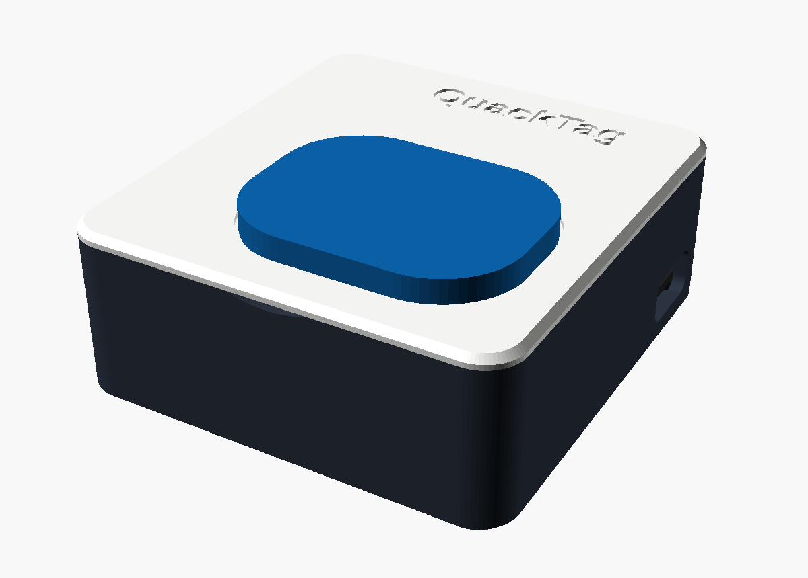

# QuackTag key dock (`quacktag_dock.scad`)

A slim case for the **key device**: the Feather RP2040 and the RC522, with the 7 jumper wires inside. The key fob rests in a shallow pocket on top. The Feather rewrites it with a new code every 15 seconds while it sits there.



**Size:** 66.6 × 70.8 × 26.7 mm (2.62 × 2.79 × 1.05 in).

```
 top                                   cut through the middle (front on the right)
┌───────────────────────────┐          ┌──────────── lid (1.8 mm) ────────────┐
│            QuackTag       │  back    │ Feather plugs ▲▲   RC522 (upside down)│
│   ─ ─ glow strip ─ ─      │          │ ▐▌        ▐▌     ▀▀▀▀▀▀▀▀▀▀▀▀▀▀▀▀▀▀▀ │
│ ╭───────────────────╮     │          │ ▐▌        ▐▌      its plugs hang ▼    │
│ │   fob pocket  ))) │     │  front   │ ▀▀ Feather ▀▀  ◄USB-C    wire slack  │
│ ╰───────────────────╯     │          └──────────────────────────────────────┘
└───────────────────────────┘
```

## Why it's this shape
- **The RC522 hangs upside down right under the lid**, held by 4 snap corners.
  - Its antenna ends up about 4 mm under the fob, so rewrites are reliable.
  - Its jumper plugs hang down into the box instead of sticking up.
- **The Feather lies on the floor next to it**, pins up, with USB-C out the right wall.
- **Both sets of plugs are about 18 mm tall and sit side by side**, so nothing stacks. That's why the box is just over 1 in tall.
- **The top is smooth.** It has a fob-shaped pocket over the antenna and a debossed "QuackTag".
  - A **hidden glow strip** sits over the Feather: the lid is thinned to 0.6 mm from below. Print the lid in **white**, and the Feather's light shows through: green for each new code, red for an error.
- **The spare wire** coils in the space under the RC522.
  - 10 cm jumpers fit best.
  - 20 cm ones also fit if you loop them.

## Parts

Ready-made STL files are in [`stl/`](stl/). Open them straight in PrusaSlicer, no OpenSCAD needed.

| Part | File | Print it | Time on the CORE One+ (approx.) |
|---|---|---|---|
| Base | `quacktag_dock_base.stl` | floor down, any dark PLA (charcoal or navy look best) | ~1 h 30 min |
| Lid | `quacktag_dock_lid.stl` | already upside down (smooth top on the bed), **white PLA** | ~35 min |
| Fit test | `quacktag_dock_fit_test.stl` | flat | ~15 min |

| PrusaSlicer setting | Value |
|---|---|
| Printer / filament | Original Prusa CORE One+ / Prusament PLA |
| Layer height | 0.20 mm (0.15 mm for the lid looks nicer) |
| Perimeters | 3 |
| Infill | 15% gyroid |
| Supports | **None** |
| Bed | Smooth sheet, so the top of the lid comes out glossy |

**Print the fit test first.** It's the Feather's 4 pegs, one short end of the RC522 holder, and a USB-C opening:
- The Feather should press onto the pegs snugly.
- The RC522's short end should click between the two corners and sit flat.
- Your USB-C plug should pass through the gauge.

If a fit is off, change the setting at the top of `quacktag_dock.scad` and export again (see below):

| Problem | Setting |
|---|---|
| Feather pegs too tight or loose | `fe_peg_d` (±0.1) |
| RC522 doesn't fit | `rc_l`, `rc_w` (measure your board) |
| USB-C plug doesn't fit | `usb_cut` |
| Lid too tight or loose in the base | `fit` (±0.05) |
| A plug touches the lid or the floor | `plug_h` (measure: header plastic + plug + 2 mm) |

## Put it together (5 minutes)
1. **Leave all 7 jumpers plugged into both boards.** The wiring doesn't change.
2. **Feather:** press it onto the 4 pegs in the base.
   - USB-C goes into the opening in the **right** wall.
   - The **long** header row goes along the back wall.
3. **RC522:**
   1. Turn the lid upside down.
   2. Lay the RC522 in it **upside down** too, with its **chip and pins facing you**.
   3. Put the 8-pin header end **away from the fob pocket**, so the antenna end sits under the pocket.
   4. Press it down until all 4 corners click.
4. **Wires:** coil the spare wire loosely in the space at the front-left, under where the RC522 will be.
5. **Close:** set the lid on the base, with the RC522 over the empty front half. Press it down until it sits flush. To open it again, lift it at the finger scoop on the front edge.
6. **Plug in USB-C** and lay the fob in the pocket. Each new code makes the glow strip flash green.

To flash by hand (the BOOT and RESET buttons), lift the lid off. The Feather stays on its pegs.

## Editing the model
1. Install OpenSCAD (`winget install OpenSCAD.OpenSCAD`) and open `quacktag_dock.scad`.
2. Press **F5** to preview the assembly.
3. Set `part` to `base`, `lid` or `fit_test`, press **F6**, then **File → Export → Export as STL**.

From the command line, from the repo root:
```
openscad -o cad/stl/quacktag_dock_lid.stl -D 'part="lid"' cad/quacktag_dock.scad
```
